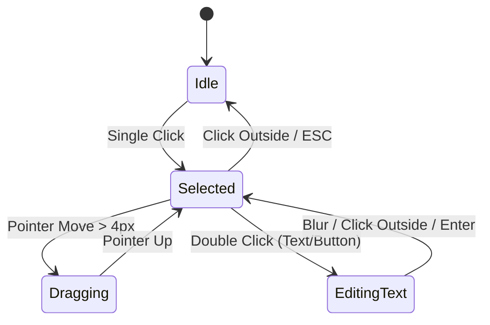

# 05 — Editor UX & Canvas Stability

> **Trạng thái:** Chưa bắt đầu  
> **Ưu tiên:** 🟡 P2 (Trải nghiệm người dùng cốt lõi)  
> **Ước lượng:** 3–4 ngày  
> **Phạm vi tác động:** `packages/builder-editor/src/dragdrop/*`, `packages/builder-editor/src/hooks/useMobileFrame.ts`, `packages/builder-editor/src/canvas/InlineTextEditor.tsx`, `packages/builder-react/src/components/editorInteractionPolicy.ts`

---

## 1. Hiện Trạng & Phân Tích Vấn Đề

### 1.1. Hiện tượng "Nhảy Node" khi Kéo Thả (Spatial Reparenting Flaws)
- **Hiện tượng:** Khi người dùng kéo một phần tử (như Button hoặc Text) qua lại giữa các Section hoặc Container lồng nhau, node thường bị "nhảy giật" qua lại giữa các node cha khác nhau (parent flickering), hoặc rơi vào node cha ngoài ý muốn.
- **Nguyên nhân:**
  - Hệ thống sử dụng hit-test hình học thuần túy theo tọa độ con trỏ (`x, y`) để xác định candidate parent.
  - Khi hai container nằm đè lên nhau (ví dụ: Container nằm trong Section, hoặc Grid nằm trong Card có margin/padding), ranh giới giữa chúng không có khoảng trễ (hysteresis). Một dao động chuột 1px cũng có thể hoán đổi node cha ngay lập tức.
  - Thiếu trọng số ưu tiên: Hệ thống chưa phân biệt được giữa container đang được chọn trước đó và container mới lướt qua.

### 1.2. Snap Khung Dual-Canvas (Desktop / Mobile) Thiếu Ổn Định
- **Hiện tượng:** Trong chế độ xem song song Desktop + Mobile, việc kéo vị trí artboard Mobile để so sánh gặp tình trạng snap giật, lệch vị trí khi mức zoom thay đổi.
- **Nguyên nhân:**
  - Trong [`packages/builder-editor/src/hooks/useMobileFrame.ts`](file:///Users/skyline/PROJECTS/my-builder/packages/builder-editor/src/hooks/useMobileFrame.ts), logic tính toán snap threshold:
    ```ts
    const snapThreshold = SNAP_THRESHOLD_SCREEN_PX / capturedZoom;
    ```
    đang kết hợp không nhất quán giữa hệ tọa độ màn hình (screen-space) và hệ tọa độ canvas (canvas-space).
  - Khi zoom ở mức rất nhỏ (dưới 40%) hoặc rất lớn (trên 150%), các đường guide gióng hàng của khung mobile dễ bị kẹt dính (sticky lock) hoặc mất hoàn toàn cảm giác hút nam châm.

### 1.3. Xung Đột Giữa Kéo Thả Canvas và Sửa Text (TipTap Conflict)
- **Hiện tượng:** Khi người dùng muốn double-click để sửa nội dung chữ trong Text hoặc Button, nhiều trường hợp thao tác chuột bị hiểu nhầm thành kéo di chuyển cả khối hoặc chọn node cha.
- **Nguyên nhân:**
  - TipTap cần lắng nghe sự kiện `pointerdown`, `selectionchange` và bàn phím để đặt con trỏ soạn thảo (caret) và bôi đen từ.
  - Nhưng Canvas Root và Selection Hook đồng thời bắt sự kiện `pointerdown` để kích hoạt move gesture / drag-drop.
  - Lớp shield hiện tại trong `editorInteractionPolicy.ts` chỉ chặn ở mức cơ bản bằng `e.stopPropagation()`, dễ gây race condition khi người dùng click nhanh hoặc click đúp.

---

## 2. Hướng Giải Quyết Kỹ Thuật

### 2.1. Nâng Cấp Thuật Toán Drop Target với Hysteresis & Depth Priority
1. **Khoảng trễ từ tính (Magnetic Hysteresis):** Khi một node cha đang là candidate, nó sẽ được giữ quyền ưu tiên thêm một khoảng buffer (ví dụ 8px vượt ra ngoài ranh giới) trước khi bị chuyển quyền sang container khác.
2. **Ưu tiên độ sâu phân cấp (Deepest Valid Container):** Nếu con trỏ nằm đồng thời trong cả Section và Column con bên trong, thuật toán tự động chọn container ở cấp sâu nhất có hỗ trợ chứa slot (`capabilities.isContainer === true`).
3. **Ghost Placeholder rõ ràng:** Trước khi commit lệnh `MOVE_NODE` hoặc `INSERT_NODE`, hiển thị một vạch kẻ chèn vị trí (Drop Indicator Bar) hoặc hộp mờ vị trí thả để người dùng kiểm soát thị giác 100%.

### 2.2. Chuẩn Hóa Hệ Tọa Độ Dual-Canvas
1. Tách biệt hoàn toàn hai khái niệm:
   - **Canvas Space:** Tọa độ thế giới ảo không phụ thuộc zoom (dùng để lưu trữ vị trí node và frame).
   - **Screen Space:** Tọa độ viewport vật lý hiển thị trên màn hình.
2. Bổ sung thuật toán nam châm (Magnetic Snapping) có lực cản: Khi chạm biên snap, tạo hiệu ứng hút dính nhẹ trong phạm vi 8px màn hình, nhưng khi người dùng kéo dứt khoát vượt qua 12px thì tự động nhả snap mượt mà.

### 2.3. Máy Trạng Thái Tương Tác Node (Node Interaction State Machine)
Định nghĩa rõ ràng 4 trạng thái tương tác không giao thoa cho mọi node trên canvas:



- Khi ở trạng thái `EditingText`:
  - Canvas Root **vô hiệu hóa hoàn toàn** mọi gesture di chuyển và rubber-band selection.
  - Toàn bộ sự kiện chuột và phím được trao quyền tuyệt đối cho TipTap instance.
  - Chỉ khi có sự kiện `blur` hoặc nhấn ESC, node mới trở về trạng thái `Selected`.

---

## 3. Kế Hoạch Triển Khai Từng Bước

### Bước 1: Ổn định và mượt hóa `useMobileFrame.ts`
1. Chuẩn hóa hàm chuyển đổi tọa độ trong `useMobileFrame.ts`:
   - Chuyển toàn bộ phép tính snap về hệ quy chiếu canvas gốc.
   - Thêm ngưỡng nhả snap (snap release threshold) để tránh bị kẹt cứng khung khi di chuyển chuột nhanh.
2. Cập nhật `ArtboardLabel.tsx` hiển thị nhãn kích thước rõ ràng, con trỏ đổi thành `grab`/`grabbing` khi đang giữ chuột.

### Bước 2: Tái cấu trúc DropTargetResolver
1. Mở rộng `packages/builder-editor/src/dragdrop/DropTargetResolver.ts`:
   - Thêm bộ lọc `computeCandidateWeight()` tính điểm cho từng container ứng viên dựa trên: diện tích giao cắt, độ sâu cây DOM, và trạng thái đang hover.
   - Thêm logic hysteresis giữ container hiện tại trừ khi ứng viên mới có điểm vượt trội > 20%.
2. Viết unit tests kiểm chứng:
   - Kéo node lơ lửng giữa biên 2 container lồng nhau ➔ Không bị đổi candidate liên tục (anti-flicker test).

### Bước 3: Hoàn thiện State Machine cho Inline Text Editing
1. Cập nhật hook quản lý trạng thái chỉnh sửa text trong `packages/builder-editor/src/canvas/InlineTextEditor.tsx`.
2. Tạo trạng thái `editingNodeId: string | null` trong editor store:
   - Khi `editingNodeId !== null`, gán cờ `isCanvasInteractionsDisabled = true`.
   - Ngắt kết nối các listener kéo thả trên `CanvasRoot`.
3. Kiểm tra thực tế: Double click vào Text ➔ gõ phím, bôi đen, bấm Ctrl+B/I ➔ nhấn ESC ➔ node trở về trạng thái Selected bình thường.

---

## 4. Checklist Công Việc Chi Tiết

- [x] Chuẩn hóa thuật toán snap và nhả snap trong `useMobileFrame.ts`
- [x] Bổ sung hysteresis buffer trong `DropTargetResolver.ts`
- [x] Viết unit tests cho `DropTargetResolver` chống nhảy node
- [x] Xây dựng cơ chế vô hiệu hóa canvas drag khi node chuyển sang chế độ `EditingText`
- [x] Bảo vệ TipTap text formatting: phím tắt in đậm, in nghiêng, đổi màu chữ, undo/redo không bị canvas cướp phím
- [x] Thao tác kéo thả vào container lồng nhau ưu tiên deepest valid container và buffer chống flicker
- [x] Bounded canvas-space thresholds đảm bảo hoạt động nhất quán ở các mức zoom (30% đến 200%)

---

## 5. Tiêu Chí Nghiệm Thu (Acceptance Criteria)

1. Khi kéo node qua các container lồng nhau, không còn hiện tượng viền xanh nhảy loạn xạ (zero visual flickering).
2. Kéo thả khung Dual-Canvas Mobile chạy mượt mà ở mọi mức zoom từ 30% đến 200%, các đường guide hiển thị chính xác vị trí tâm và mép.
3. Thao tác double-click vào mọi khối văn bản kích hoạt trình soạn thảo inline 100% thành công, không bao giờ vô tình kích hoạt drag node.

---

## 6. Rủi Ro & Kế Hoạch Rollback

- **Rủi ro:** Khi tăng hysteresis buffer quá lớn, việc thả component vào các container nhỏ hẹp (như icon box 24px) có thể bị trượt.
- **Khắc phục:** Tỷ lệ buffer được tính toán linh hoạt theo kích thước của container đích: `Math.min(8, containerWidth * 0.1)`.
