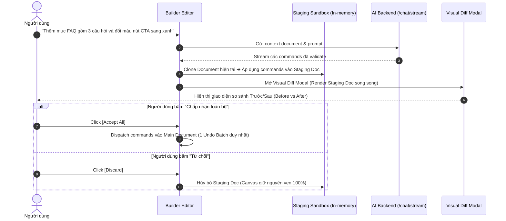

# 08 — AI Generation Flexibility & Visual Diff Preview

> **Trạng thái:** ✅ Đã hoàn thành  
> **Ưu tiên:** 🟢 P4 (Nâng cao trải nghiệm AI & Trợ lý thông minh)  
> **Ước lượng:** 4–5 ngày  
> **Phạm vi tác động:** `apps/api/src/services/*`, `packages/builder-editor/src/ai/*`

---

## 1. Hiện Trạng & Phân Tích Giới Hạn Hiện Tại

### 1.1. Thiếu Cơ Chế Xem Trước (No Visual Diff / Preview Before Apply)
- **Hiện trạng:** Khi người dùng trò chuyện với Trợ lý AI (AIAssistant) hoặc sinh trang (Page Generator):
  - Hệ thống gửi prompt lên backend (`apps/api`).
  - Backend trả về danh sách lệnh commands (`ADD_NODE`, `UPDATE_NODE_PROPS`, `SET_STYLE`...).
  - Client editor lập tức thực thi thẳng (`dispatch`) toàn bộ danh sách lệnh vào `BuilderDocument` thật.
- **Hệ lụy trong thực tế sử dụng:**
  - Nếu AI sinh ra bố cục không ưng ý hoặc đổi màu làm hỏng giao diện hiện tại, người dùng bị giật mình vì canvas bị thay đổi tức thì.
  - Giải pháp duy nhất hiện nay là bấm nút "Undo". Tuy nhiên, nếu thao tác AI bao gồm nhiều command hoặc người dùng muốn giữ lại 1 phần (ví dụ: thích phần Header mới nhưng muốn bỏ phần Testimonial) thì hệ thống hoàn toàn không hỗ trợ.

### 1.2. Phụ Thuộc Nặng Nề Vào Template JSON Cứng (Rigid Template Lock-in)
- **Hiện trạng:**
  - Logic biên dịch layout ở backend trong `section-plan-compiler.ts` và `data/content-packs/` phụ thuộc vào các file JSON mẫu định sẵn theo từng ngành nghề.
  - LLM chỉ đóng vai trò điền text và chọn preset có sẵn.
- **Hệ lụy:**
  - Khi người dùng yêu cầu các cấu trúc sáng tạo, độc lạ hoặc phong cách layout bất quy tắc, backend sẽ cố ép vào các preset có sẵn; nếu không khớp schema sẽ bị Quality Gate loại bỏ (`droppedCommands`).
  - Hệ thống AI thiếu khả năng tự do sáng tạo tổ hợp component (Component Composition Synthesis).

---

## 2. Hướng Giải Quyết Kỹ Thuật

### 2.1. Kiến Trúc Staging Sandbox & Visual Diff Preview
Xây dựng cơ chế Sandbox Document trên client trước khi ghi đè vào lịch sử:

### 2.2. Hỗ Trợ Partial Accept (Chấp Nhận Từng Phần)
- Gom nhóm danh sách command theo từng Section hoặc mục tiêu tương tác:
  - Nhóm 1: `Section: FAQ` (các lệnh `ADD_NODE`)
  - Nhóm 2: `Button: CTA` (các lệnh `UPDATE_NODE_PROPS`)
- Giao diện Diff cho phép người dùng tick chọn từng nhóm muốn giữ lại trước khi commit vào canvas.

### 2.3. Tận Dụng Component Retrieval & aiHints Động (Flexible Composition)
- Tận dụng các tính năng đã phát triển gần đây ở Phase 4 (`aiHints` và `component-retrieval`):
  - Khi prompt yêu cầu một thành phần chưa có preset định sẵn, hệ thống dùng vector/keyword retrieval để tìm kiếm các component phù hợp (như `CollapsibleText`, `Repeater`, `Form`, `Image`).
  - LLM được cung cấp trực tiếp schema `aiHints` của các component đó để tự do kết hợp thành cấu trúc Section mới, không bị gò bó trong danh mục content-packs cố định.

---

## 3. Kế Hoạch Triển Khai Từng Bước

### Bước 1: Xây dựng Staging Document Executor trên Client
1. Tạo file `packages/builder-editor/src/ai/stagingDocument.ts`:
   - Hàm `createStagingDocument(baseDoc: BuilderDocument): BuilderDocument`.
   - Hàm `applyCommandsToStaging(stagingDoc, commands): { nextDoc: BuilderDocument, groupedChanges: AIChangeGroup[] }`.

### Bước 2: Xây dựng Component Visual Diff Modal
1. Tạo `packages/builder-editor/src/ai/AIDiffPreviewModal.tsx`:
   - Chế độ xem Split View (Side-by-side) hoặc Toggle View (Before / After).
   - Sử dụng chính `RuntimeRenderer` để render Staging Document (không tải thêm dependency nào khác).
   - Bảng danh sách các thay đổi (Change Checklist) cho phép người dùng bật/tắt từng thay đổi.

### Bước 3: Nâng cấp luồng hội thoại trong `AIAssistant.tsx`
1. Khi nhận lệnh từ AI:
   - Thay vì gọi trực tiếp `builder.dispatch(...)`, mở `AIDiffPreviewModal`.
   - Hiển thị badge tóm tắt: "AI đề xuất 2 thay đổi mới".
2. Bổ sung nút bấm [Review Changes] ngay trong bong bóng chat.

### Bước 4: Mở rộng tính linh hoạt của Compiler ở Backend
1. Tại `apps/api/src/services/section-plan-compiler.ts`:
   - Cho phép fallback sang generic composite section nếu không tìm thấy preset trùng khớp.
   - Kết nối với `component-contract-resolver.ts` để sinh layout tự do dựa trên khả năng của từng component (như container, inline-editable, slot-holder).

---

## 4. Checklist Công Việc Chi Tiết

- [x] Tạo module `stagingDocument.ts` clone và áp dụng lệnh vào bộ nhớ tạm
- [x] Xây dựng component `AIDiffPreviewModal.tsx` hỗ trợ so sánh Before/After
- [x] Hỗ trợ xem trước responsive (Desktop / Tablet / Mobile) trong modal Diff
- [x] Xây dựng tính năng gom nhóm commands theo section để cho phép Partial Accept
- [x] Cập nhật `AIAssistant.tsx` chuyển từ Auto-apply sang Review-before-apply
- [x] Nâng cấp `section-plan-compiler.ts` hỗ trợ tự do sinh layout từ `aiHints`
- [x] Viết unit tests cho `stagingDocument.ts` kiểm tra tính bất biến của Document gốc
- [x] Kiểm thử e2e & unit test: Staging isolation ➔ Modal Diff hiển thị ➔ Discard ➔ Canvas untouched ➔ Accept Selected/All ➔ Single atomic undo batch commit

---

## 5. Tiêu Chí Nghiệm Thu (Acceptance Criteria)

1. Mọi phản hồi từ AI Chat có sinh command đều đi qua giao diện Visual Diff Preview trước khi áp dụng vào canvas chính.
2. Người dùng có thể xem trước giao diện mới, so sánh với giao diện cũ, và từ chối (Discard) với 0% rủi ro làm hỏng trang đang dựng.
3. Thao tác Accept All chỉ tạo ra đúng 1 entry duy nhất trong History Stack (1 lần bấm Undo là quay về trạng thái cũ).
4. AI có khả năng tạo ra các bố cục mới không nằm trong bộ content-packs cứng.

---

## 6. Rủi Ro & Kế Hoạch Rollback

- **Rủi ro:** Khi render đồng thời cả 2 document (Before và After) trong modal, trình duyệt có thể bị tốn bộ nhớ nếu trang có dung lượng ảnh lớn.
- **Khắc phục:** Sử dụng preview ở dạng container thu nhỏ (scaled artboard) và lazy-load hình ảnh trong modal diff.
- **Kế hoạch Rollback:** Bổ sung cấu hình tùy chọn trong Settings: `"ai.autoApply": false` (mặc định mở Diff, nếu người dùng muốn thao tác nhanh có thể bật auto-apply như cũ).
