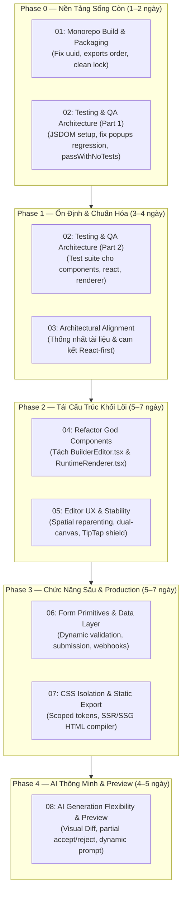

# Roadmap Tái Thiết & Nâng Cấp Toàn Diện (V2) — UI Builder Library

> **Thời điểm lập:** 2026-10-11  
> **Cơ sở dữ liệu:** Báo cáo audit chuyên sâu toàn bộ mã nguồn, build pipeline, test suite và kiến trúc hệ thống.  
> **Phạm vi:** Toàn bộ monorepo (`packages/*`, `apps/*`, docs).  
> **Lưu ý:** Vấn đề bundle size của `builder-editor` được giữ nguyên theo đặc thù kỹ thuật (editor cần TipTap, ColorPicker, Lucide để vận hành, không ảnh hưởng runtime render).

---

## 1. Mục Tiêu Tổng Thể

1. **Xóa sạch nợ kỹ thuật nền móng:** Build thành công 100% monorepo, test suite xanh toàn bộ (`pnpm test`), dọn dẹp rác repository.
2. **Khắc phục khoảng trống kiểm thử:** Đưa JSDOM vào Vitest, lấp đầy coverage cho 17+ components và RuntimeRenderer.
3. **Phân rã các khối "God Files":** Tái cấu trúc `BuilderEditor.tsx` (1.493 dòng) và `RuntimeRenderer.tsx` (1.557 dòng) thành các controller/engine đơn trách nhiệm.
4. **Chuẩn hóa kiến trúc & tài liệu:** Thống nhất thực tế triển khai React-first và ranh giới framework-agnostic của core.
5. **Nâng tầm trải nghiệm Editor & UX:** Ổn định Spatial Reparenting, mượt hóa Dual-Canvas Snap, cách ly xung đột Inline Text Editor.
6. **Hoàn thiện tính năng Production & Runtime:** Form validation/submission thực thụ, cô lập CSS namespace tránh xung đột host app, hỗ trợ Static HTML/CSS Export cho SEO.
7. **Nâng cấp phân hệ AI:** Cơ chế Visual Diff/Preview trước khi áp dụng lệnh AI, giảm phụ thuộc vào preset cứng.

---

## 2. Bản Đồ Hạng Mục & Thứ Tự Thực Hiện (Phases)

---

## 3. Danh Mục Chi Tiết Từng Kế Hoạch (Sub-plans)

| Mã | File Kế Hoạch | Trọng Tâm | Mức Độ | Ước Lượng | Trạng Thái |
|:---|:---|:---|:---:|:---:|:---:|
| **01** | [`01-monorepo-build-and-packaging.md`](./01-monorepo-build-and-packaging.md) | Sửa lỗi `uuid` build presets, chuẩn hóa export conditions nodenext, dọn `package-lock.json` và `figma-response.json` | 🔴 P0 | 1 ngày | ✅ Hoàn thành |
| **02** | [`02-testing-qa-architecture.md`](./02-testing-qa-architecture.md) | Cấu hình JSDOM/Happy-DOM cho Vitest, sửa test fail popup regression, xây dựng test suite cho `builder-components`, `builder-react`, `builder-renderer` | 🔴 P0/P1 | 3 ngày | ✅ Hoàn thành |
| **03** | [`03-architectural-alignment.md`](./03-architectural-alignment.md) | Chuẩn hóa ranh giới kiến trúc: xác định rõ `builder-core` headless vs `builder-components` React-first, cập nhật đồng bộ README/ARCHITECTURE | 🟡 P1 | 1 ngày | ✅ Hoàn thành |
| **04** | [`04-refactor-god-components.md`](./04-refactor-god-components.md) | Phân rã `BuilderEditor.tsx` (1.493 dòng) và `RuntimeRenderer.tsx` (1.557 dòng) thành các controller, engine và render pipeline độc lập | 🟡 P2 | 4 ngày | ✅ Hoàn thành |
| **05** | [`05-editor-ux-and-stability.md`](./05-editor-ux-and-stability.md) | Ổn định Spatial Reparenting chống nhảy node, mượt hóa Dual-Canvas Artboard Snap, cô lập xung đột TipTap inline-edit | 🟡 P2 | 3 ngày | ✅ Hoàn thành |
| **06** | [`06-form-primitives-and-data-layer.md`](./06-form-primitives-and-data-layer.md) | Bổ sung dynamic validation schema (Zod/Regex), state helper, anti-spam, multi-step, webhook handler cho Form primitives | 🟢 P3 | 3 ngày | ✅ Hoàn thành |
| **07** | [`07-css-isolation-and-static-export.md`](./07-css-isolation-and-static-export.md) | Namespace CSS tokens tránh va chạm host app, xây dựng Static HTML/CSS Compiler cho RuntimeRenderer (SEO & LCP) | 🟢 P3 | 3 ngày | ✅ Hoàn thành |
| **08** | [`08-ai-generation-preview-and-flexibility.md`](./08-ai-generation-preview-and-flexibility.md) | Visual Diff/Preview trước khi apply lệnh AI, cho phép partial accept/reject, giảm phụ thuộc vào preset JSON cứng | 🟢 P4 | 4 ngày | ✅ Hoàn thành |

---

## 4. Nguyên Tắc Thực Hiện (Guiding Principles)

1. **Strict Command Pattern**: Mọi thao tác chỉnh sửa state của document vẫn bắt buộc phải đi qua Command Pattern (`builder.dispatch({ type, payload })`). Tuyệt đối không mutate state trực tiếp.
2. **Zero Regressions**: Trước khi refactor bất kỳ module nào (như `BuilderEditor` hay `RuntimeRenderer`), phải đảm bảo test suite bao phủ hiện trạng để không làm vỡ các hành vi đã ổn định.
3. **Additive & Backward-Compatible**: Đối với schema và API contract, tuân thủ nguyên tắc mở rộng tương thích ngược (Additive changes) kèm migration script nếu sửa đổi schema.
4. **Continuous Verification**: Sau mỗi bước trong checklist, chạy:
   - `pnpm -r typecheck` (Đảm bảo type safety)
   - `pnpm -r build` (Đảm bảo bundle không gãy)
   - `pnpm -r test` (Đảm bảo logic xanh toàn bộ)
